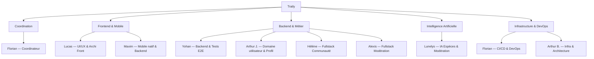
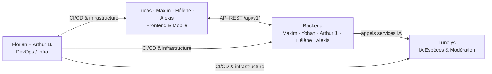

# Organization Breakdown Structure — Traily

## Structure générale

L'équipe compte **9 membres actifs**. Florian assure la coordination générale. Chaque membre dispose d'une autonomie forte sur son périmètre ; les décisions d'architecture transversales sont prises collectivement entre les profils concernés.

---

## Rôles et responsabilités

### Florian — Coordinateur / DevOps

**Périmètre :** vision produit, planification, cohérence d'équipe, infrastructure CI/CD.

| Responsabilité  | Détail                                                          |
| --------------- | --------------------------------------------------------------- |
| Coordination    | Suivi d'avancement, gestion du backlog, facilitation des syncs  |
| Arbitrage       | Décisions impactant plusieurs composants                        |
| CI/CD           | Pipelines par composant (lint, tests, build, sécurité)          |
| Environnements  | Gestion `development` / `staging` / `production`                |
| Qualité globale | Veille au respect des Quality Plans et de la Definition of Done |

---

### Lucas — Frontend UI/UX & Architecture Front

**Périmètre :** application mobile Expo / React Native — architecture frontend, expérience utilisateur, écrans produit.

| Responsabilité          | Détail                                                                                  |
| ----------------------- | --------------------------------------------------------------------------------------- |
| Architecture front      | Structure des composants, navigation, design system, conventions TypeScript             |
| Écrans principaux       | Accueil, carte, profil utilisateur, fiche trail, paramètres                             |
| Écrans scores           | Affichage du score utilisateur, historique de points, classements (trace/région/équipe) |
| Écrans collections      | Herbier et bestiaire — liste, fiche détail, ajout d'observation                         |
| Écrans espèces          | Liste des espèces observables par trace, fiche espèce, carte de distribution            |
| Alertes zones sensibles | Overlay carte zones protégées, messages d'avertissement contextuels                     |

---

### Maxim — Mobile natif & Backend

**Périmètre :** fonctionnalités natives de l'application mobile, logique métier backend, renfort UI/UX.

| Responsabilité      | Détail                                                                                      |
| ------------------- | ------------------------------------------------------------------------------------------- |
| GPS & trace         | Suivi GPS foreground/background (`expo-location`), enregistrement et visualisation de trace |
| Caméra & photo      | Capture photo géolocalisée (`expo-camera`), extraction EXIF, épinglage sur trace            |
| Mode offline        | Persistance SQLite (`expo-sqlite`), queue de sync, détection réseau                         |
| Renfort UI/UX       | Contribution aux écrans en support de Lucas selon les besoins                               |
| Backend Go          | Endpoints API REST, handlers, middlewares, logique métier                                   |
| Domaine scores      | API calcul de points par action utilisateur, persistance (partagé avec Yohan)               |
| Intégration espèces | Import et normalisation des données GBIF / iNaturalist côté backend                         |
| Architecture        | Contribution aux décisions d'architecture applicative                                       |

---

### Yohan — Backend & Tests E2E

**Périmètre :** logique métier backend, architecture applicative, mise en place et maintenance des tests end-to-end.

| Responsabilité      | Détail                                                                            |
| ------------------- | --------------------------------------------------------------------------------- |
| Backend Go          | Endpoints API REST, handlers, middlewares, logique métier                         |
| Domaine scores      | Calcul de points par action utilisateur, classements, persistance (partagé Maxim) |
| Tests E2E           | Stratégie, implémentation et maintenance des tests end-to-end                     |
| CI jobs E2E         | Configuration des jobs CI dédiés aux tests E2E                                    |
| Architecture        | Contribution aux décisions d'architecture applicative                             |

---

### Lunelys — IA Espèces & Modération

**Périmètre :** identification d'espèces, vérification de contenu, recommandation de traces. Deux pipelines IA distincts selon le type de photo.

| Responsabilité                    | Détail                                                                                           |
| --------------------------------- | ------------------------------------------------------------------------------------------------ |
| Identification d'espèces          | Modèle de reconnaissance flore/faune à partir de photos (ML Python), inclut vérification NSFW   |
| Pipeline NSFW photos de trajet    | Vérification NSFW indépendante pour les photos postées en cours de randonnée (pipeline séparé)   |
| Personnalisation & recommandation | Recommandation de traces selon historique, collections et score utilisateur                      |
| API FastAPI                       | Endpoints `POST /identify`, `POST /verify`, `POST /recommend`, Pydantic models                  |

---

### Arthur J. — Domaine utilisateur & Profil

**Périmètre :** domaine utilisateur côté backend (comptes, authentification, profils, sessions) et personnalisation du profil selon l'activité, en lien avec les services IA de Lunelys.

| Responsabilité             | Détail                                                                                                |
| -------------------------- | ----------------------------------------------------------------------------------------------------- |
| Domaine utilisateur        | Authentification, profils, historique de randonnées, sessions                                         |
| Personnalisation du profil | Adaptation du profil utilisateur (préférences, contenus et suggestions mis en avant) selon l'activité |
| Avatar & compagnon         | UI/UX de l'avatar sur la carte et logique d'obtention du compagnon animal (bonus, avec Lucas)         |

---

### Arthur B. — Infrastructure & Architecture

**Périmètre :** infrastructure cloud, architecture backend, supervision technique transversale.

| Responsabilité           | Détail                                                                       |
| ------------------------ | ---------------------------------------------------------------------------- |
| Conteneurisation         | Dockerfiles multi-stage, `docker-compose.yml`, orchestration                 |
| Base de données          | PostgreSQL + PostGIS, migrations, sauvegardes, zones géographiques sensibles |
| Supervision architecture | Revues d'architecture backend, cohérence technique transversale              |
| Stockage objet           | Configuration S3 / MinIO (photos géolocalisées, tuiles offline)              |
| Observabilité            | Logs JSON structurés, métriques Prometheus, alertes                          |

---

### Hélène — Fullstack Communauté

**Périmètre :** ownership du module communauté de bout en bout, backend et frontend.

| Responsabilité          | Détail                                                              |
| ----------------------- | ------------------------------------------------------------------- |
| Backend communauté      | Équipes / clans : création, invitations, rôles, gestion des membres |
| Feed social             | Activité communautaire par trace, par équipe, par région            |
| Scores d'équipe         | Agrégation des points, classements collectifs                       |
| Notifications push      | Système de notifications (scores, validations, activité équipe)     |
| Frontend communauté     | Écrans équipes, feed, classements d'équipe                          |

---

### Alexis — Fullstack Modération

**Périmètre :** ownership du module modération de bout en bout — workflow humain de validation du contenu soumis par la communauté.

| Responsabilité          | Détail                                                                          |
| ----------------------- | ------------------------------------------------------------------------------- |
| Dashboard modération    | Écran de revue des photos soumises, actions accepter / rejeter, historique      |
| Système de signalement  | Interface utilisateur pour signaler un contenu, file de traitement backend      |
| Backend modération      | API validation / rejet de photos, gestion des signalements, historique          |
| Intégration IA          | Consommation des résultats des pipelines de Lunelys pour alimenter la file humaine |

---

## Ownership des modules produit

| Module                             | Owner UI  | Owner Backend       | Owner IA  |
| ---------------------------------- | --------- | ------------------- | --------- |
| Navigation GPS & Traces            | Lucas     | Maxim               | —         |
| Espèces observables par trace      | Lucas     | Maxim               | Lunelys   |
| Identification photo (flore/faune) | Lucas     | Maxim / Yohan       | Lunelys   |
| Collections (herbier / bestiaire)  | Lucas     | Maxim / Yohan       | Lunelys   |
| Scores & classements               | Lucas     | Maxim / Yohan       | —         |
| Communauté & équipes               | Hélène    | Hélène              | —         |
| Modération & signalements          | Alexis    | Alexis              | Lunelys   |
| Zones sensibles / cadre éthique    | Lucas     | Arthur B.           | —         |
| Profil utilisateur                 | Lucas     | Arthur J.           | Arthur J. |
| Infrastructure & DevOps            | —         | Arthur B. + Florian | —         |

---

## Responsabilités transversales

| Responsabilité       | Attendu de chacun                                                                                       |
| -------------------- | ------------------------------------------------------------------------------------------------------- |
| Revue de code        | Toute PR doit être approuvée par au moins un autre membre avant merge                                   |
| Conventional Commits | `feat:`, `fix:`, `chore:`, `docs:`, `test:` sur toutes les branches                                     |
| Definition of Done   | Chacun vérifie sa propre checklist avant de soumettre une PR                                            |
| Tests                | Couverture cible à 60–70% sur les chemins critiques ; plus souple sur les fonctionnalités non critiques |
| Documentation        | Mise à jour du doc concerné si une PR modifie une interface ou un comportement                          |

---

## Interfaces entre rôles

- Le **Backend** est l'unique consommateur des services IA — le Frontend ne les appelle jamais directement.
- **Maxim** contribue au backend et aux fonctionnalités natives mobile ; il apparaît des deux côtés de l'interface.
- **Alexis** consomme les résultats des pipelines IA de Lunelys pour alimenter la file de modération humaine.
- **Arthur B.** supervise l'architecture backend sans en être owner fonctionnel.
- **Florian** n'est pas un intermédiaire obligatoire entre développeurs — les décisions locales restent autonomes.
