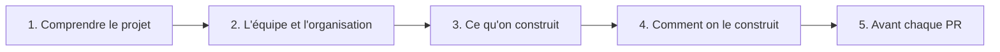

# Ordre de lecture — Traily

> Par où commencer dans la documentation, et quelles informations trouver dans chaque document. À lire en premier en arrivant sur le projet.

---

## Vue d'ensemble

| #   | Document                                                   | Question à laquelle il répond                         |
| --- | ---------------------------------------------------------- | ----------------------------------------------------- |
| 1   | [README](../README.Md)                                     | C'est quoi Traily, et comment je lance le projet ?    |
| 2   | [WBS.md](./WBS.md) — Parties 1 et 2                        | Quel est le concept, pour qui, avec quels grands blocs ? |
| 3   | [PBS.md](./PBS.md)                                         | De quoi est composé le produit ?                      |
| 4   | [OBS.md](./OBS.md)                                         | Qui fait quoi dans l'équipe ?                         |
| 5   | [DEVELOPMENT_PROCESS.md](./DEVELOPMENT_PROCESS.md)         | Comment l'équipe travaille au quotidien ?             |
| 6   | [TOOLS.md](./TOOLS.md)                                     | Quels outils on utilise, et pour quoi ?               |
| 7   | [LINEAR_GUIDE.md](./LINEAR_GUIDE.md)                       | Comment on utilise Linear ?                           |
| 8   | [WBS.md](./WBS.md) — Parties 3 et 4                        | Quels livrables, tâches et critères d'acceptation ?   |
| 9   | [BACKLOG.md](./BACKLOG.md)                                 | Quelles stories étaient prévues au cadrage ? (figé, suivi dans Linear) |
| 10  | [ARCHITECTURE.md](./ARCHITECTURE.md)                       | Comment le système est construit techniquement ?      |
| 11  | [HARDWARE_REQUIREMENTS.md](./HARDWARE_REQUIREMENTS.md)     | Sur quel matériel tourne Traily ?                     |
| 12  | [QUALITY_PLAN_FRONTEND.md](./QUALITY_PLAN_FRONTEND.md) / [QUALITY_PLAN_BACKEND.md](./QUALITY_PLAN_BACKEND.md) | Quelles règles de code suivre sur mon composant ? |
| 13  | [DEFINITION_OF_DONE.md](./DEFINITION_OF_DONE.md)           | Quand une tâche est-elle terminée ?                   |

---

## 1. Comprendre le projet

### README

Point d'entrée du dépôt.

- Présentation courte de Traily
- Stack technique (Expo, Go, FastAPI, PostgreSQL/PostGIS, MinIO, Docker)
- Installation locale : prérequis, variables d'environnement, commandes de démarrage
- Structure des dossiers du projet
- Conventions de branches, de commits et lien vers Linear

### WBS.md — Parties 1 et 2 (Dossier de cadrage)

Le cadrage du projet. Ne lire que les deux premières parties à ce stade.

- **Partie 1** : concept, utilisateur cible, stack technique, grands blocs fonctionnels
- **Partie 2** : schéma WBS, c'est-à-dire le découpage du travail en 11 blocs (socle randonnée, espèces, collections, gamification, communauté, modération, cadre éthique, backend & IA, infrastructure, gestion de projet, bonus)

### PBS.md — Product Breakdown Structure

Le découpage du **produit** (le « où ») sous forme de diagramme.

- Application mobile : écrans, GPS, caméra, collections, scores
- Backend & IA : API REST, base de données, services IA
- Infrastructure : stockage, CI/CD, monitoring, sécurité
- Communauté & modération : équipes, feed, modération, notifications
- Cadre éthique & nature : zones sensibles, alertes, conseils

---

## 2. L'équipe et l'organisation

### OBS.md — Organization Breakdown Structure

L'organisation de l'**équipe** (le « qui »).

- Organigramme par pôle (coordination, frontend, backend, IA, infra)
- Fiche de rôle de chaque membre : périmètre et responsabilités
- Tableau d'ownership des modules : owner UI, backend et IA de chaque module produit
- Responsabilités transversales (revue de code, commits, tests, documentation)
- Interfaces entre les rôles (qui appelle qui)

### DEVELOPMENT_PROCESS.md

La **méthode de travail**.

- Méthodologie (Scrum adapté), sprints de 4 semaines calés sur les vendredis d'école
- Cérémonies : Sprint Planning, Review, Rétrospective, weekly standup (Point Linear du vendredi), syncs ad hoc
- Gestion du backlog
- Workflow de développement : branches `develop` / `main`, cycle d'une tâche, règles de merge, commits
- Gestion des hotfixes
- CI/CD : checks bloquants par composant et environnements

### TOOLS.md

Les **outils** de l'équipe.

- Tableau des outils (Linear, GitHub, GitHub Actions, Discord, Figma, ce dépôt) avec leur usage, leurs admins et leurs liens
- Règles d'usage : où reporter une décision, où avoir une discussion technique

### LINEAR_GUIDE.md

Le **mode d'emploi de Linear**.

- Structure du workspace (team, cycles de 4 semaines, projets, milestones des follow-ups)
- Labels obligatoires (type + domaine + module)
- Gabarit de création d'un ticket
- Workflow des statuts (Backlog → Todo → In Progress → QA → Done)
- Dates des cycles et des milestones imposées par l'école

---

## 3. Ce qu'on construit

### WBS.md — Parties 3 et 4

Le détail du **travail à faire** (le « quoi »).

- **Partie 3** : pour chaque bloc, le livrable attendu et la liste des tâches
- **Partie 4** : pour chaque feature, un résumé, les exigences fonctionnelles et les critères d'acceptation mesurables

### BACKLOG.md

Le **backlog produit initial**, construit en croisant WBS (quoi), PBS (où) et OBS (qui). Ce document est **figé** : le suivi vivant (périmètre, avancement, tâches) se fait dans Linear.

- Méthode de construction et légende
- Vue d'ensemble des Epics avec owner principal et priorité
- Détail de chaque story : type, domaine, priorité (Must / Should / Could / Bonus), owners, user story et critères d'acceptation
- Règles de passage des stories en tickets Linear

---

## 4. Comment on le construit

### ARCHITECTURE.md

L'**architecture technique**.

- Vue d'ensemble des composants du système et stack
- Application mobile : responsabilités, fonctionnalités natives, mode hors connexion, structure des dossiers
- Backend Go : packages, flux d'une requête, conventions REST, endpoints principaux
- Micro-services IA : règle de décision Go / Python et communication avec le backend
- Base de données, authentification, stockage des fichiers
- Infrastructure et environnements de déploiement

### HARDWARE_REQUIREMENTS.md

Les **exigences matérielles**.

- Appareils mobiles des utilisateurs : capteurs requis, versions minimales d'iOS et Android
- Serveurs : API, base de données, stockage, micro-services IA
- Poste de développement
- Ce qui n'est pas requis

### QUALITY_PLAN_FRONTEND.md et QUALITY_PLAN_BACKEND.md

Les **règles de qualité** par composant. Lire celui qui correspond à son périmètre.

- Conventions de code et structure des dossiers / packages
- Règles spécifiques (fonctions natives côté front, API REST côté back)
- Stratégie de tests et sécurité
- Checks CI bloquants sur chaque PR
- Workflow de développement du composant

---

## 5. Avant chaque PR

### DEFINITION_OF_DONE.md

La **checklist** à vérifier avant de considérer une tâche comme terminée : développement, tests, qualité, revue de code, documentation et validation.

---

## Parcours rapides

| Profil                  | Documents prioritaires                                                    |
| ----------------------- | ------------------------------------------------------------------------- |
| Nouveau membre          | README → WBS (Parties 1-2) → OBS → DEVELOPMENT_PROCESS → TOOLS            |
| Développeur frontend    | ARCHITECTURE (§3) → QUALITY_PLAN_FRONTEND → DEFINITION_OF_DONE            |
| Développeur backend     | ARCHITECTURE (§4, §6-8) → QUALITY_PLAN_BACKEND → DEFINITION_OF_DONE       |
| IA                      | ARCHITECTURE (§5) → WBS (§2, §8) → BACKLOG (Epics 2 et 8)                 |
| Infra / DevOps          | ARCHITECTURE (§9) → HARDWARE_REQUIREMENTS → DEVELOPMENT_PROCESS (§6)      |
| Prise d'un ticket       | LINEAR_GUIDE → DEVELOPMENT_PROCESS (§4) → DEFINITION_OF_DONE              |
